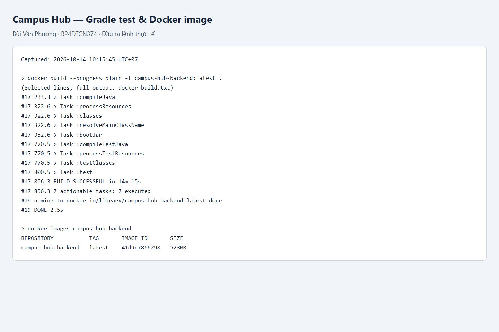
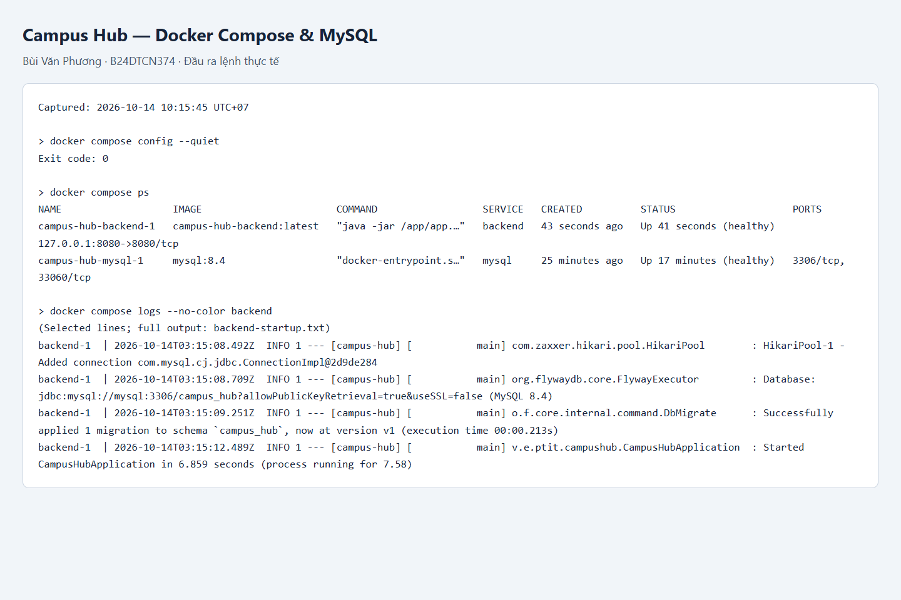
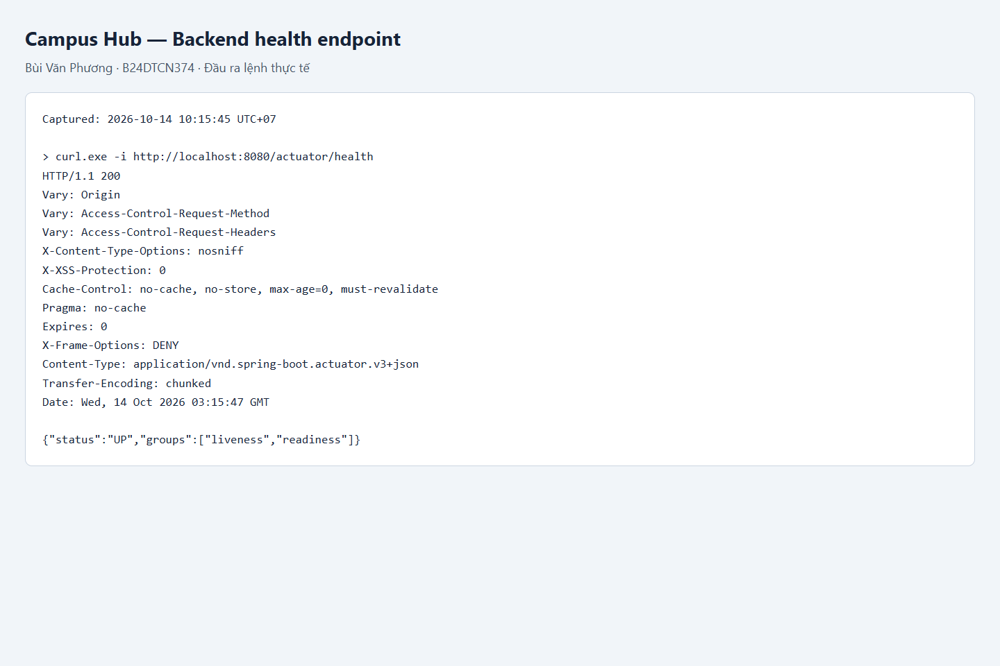

# Bài kiểm tra: Campus Hub với Docker

- Họ tên: Bùi Văn Phương.
- Mã sinh viên: **B24DTCN374**.
- Repository: https://github.com/hex2k6/IT209_SS13_miniproject_BuiVanPhuong

## Chạy hệ thống

Cần Docker Engine / Docker Desktop ở chế độ Linux containers. Thực hiện tại thư mục gốc repository:

```powershell
docker compose config --quiet
docker build --progress=plain -t campus-hub-backend:latest .
docker images campus-hub-backend
docker compose up -d --wait --wait-timeout 240
docker compose ps
curl.exe -i http://localhost:8080/actuator/health
```

Backend: **http://localhost:8080**, health check: **http://localhost:8080/actuator/health**.
Kết quả cần đạt: HTTP `200`, JSON có `"status":"UP"` và cả hai service `healthy`.

Dockerfile dùng JDK 21 để chạy `gradle --no-daemon test bootJar` (Gradle 8.14.3 khớp với Wrapper của dự án), sau đó chỉ đưa JAR vào image JRE 21, chạy bằng tài khoản không phải root. Test dùng H2 nên không cần MySQL khi build. Khi chạy Compose, backend nhận `DB_URL`, `DB_USERNAME`, `DB_PASSWORD`; URL dùng `mysql:3306` là tên service MySQL. Compose chờ MySQL truy vấn được `SELECT 1` rồi mới khởi động backend. Flyway tạo schema; Hibernate kiểm tra schema khi khởi động.

Dữ liệu MySQL lưu trong named volume `mysql_data`. Backend chỉ mở cổng trên máy cá nhân; MySQL không mở cổng ra host. Mật khẩu mặc định là dữ liệu mẫu cho bài thực hành. Có thể sao chép `.env.example` thành `.env` để đổi cấu hình; `.env` được Git bỏ qua. Nếu cổng 8080 bận, đặt `BACKEND_PORT=8081` trong `.env` và đổi URL kiểm tra tương ứng. Nếu volume đã có dữ liệu, việc đổi biến mật khẩu không tự đổi mật khẩu trong MySQL.

Kiểm thử riêng trên Windows (cần JDK 21):

```powershell
cd backend
./gradlew.bat --no-daemon test
```

Trên Linux/macOS: `cd backend && sh gradlew --no-daemon test`.
Không có JDK trên host vẫn chạy được test trong bước build Docker ở trên.

Dừng hệ thống và giữ dữ liệu:

```powershell
docker compose down
```

## Minh chứng

Đã kiểm tra thành công ngày 14/10/2026:

- Gradle `test bootJar`: `BUILD SUCCESSFUL`.
- Image `campus-hub-backend:latest` được build và có trong `docker images`.
- `docker compose config --quiet` trả mã 0; backend và MySQL đều `healthy`.
- Backend kết nối `jdbc:mysql://mysql:3306/campus_hub`; Flyway áp dụng migration thành công.
- `GET /actuator/health` trả HTTP **200**, trạng thái **UP**.

Ba ảnh dưới đây là ảnh chụp trang hiển thị đầu ra lệnh thực tế đã lưu, có trích đoạn ở phần build và startup; không phải ảnh giao diện Docker Desktop. Có thể đối chiếu với [log build đầy đủ](docs/evidence/docker-build.txt), [log startup đầy đủ](docs/evidence/backend-startup.txt) và [phản hồi HTTP](docs/evidence/health.txt).

### 1. Gradle test và Docker Image



### 2. Compose và kết nối MySQL



### 3. Health endpoint




## Tài liệu ứng dụng

Xem [chức năng, API và cách chạy frontend](docs/APP.md).
